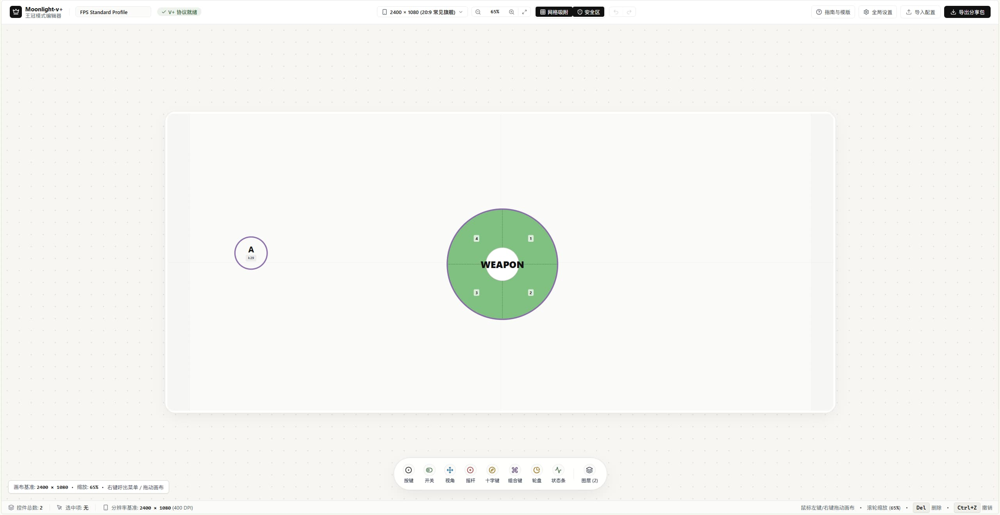
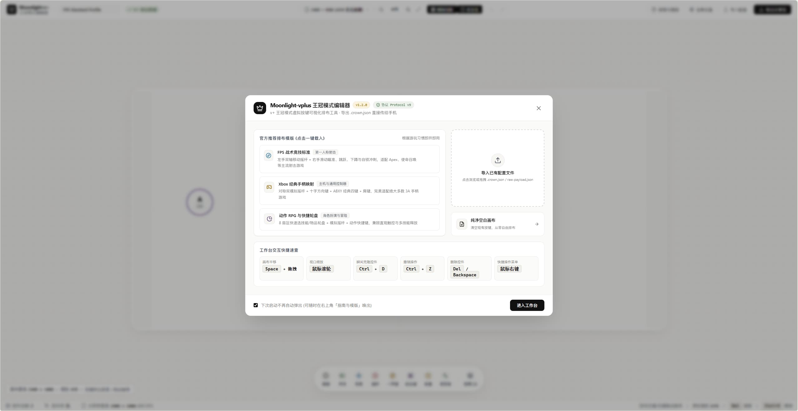
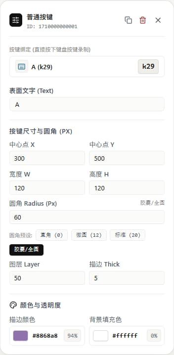
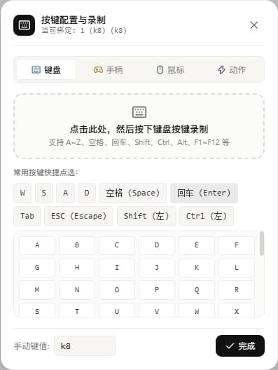
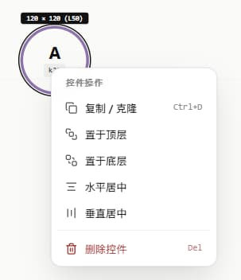
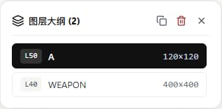

# Moonlight-vplus (v+) Crown Editor

Moonlight-vplus (v+) 王冠模式虚拟按键可视化编辑器。

在手机屏幕上排布几十个虚拟按键既费手又容易挡视线，本项目提供了一个在大屏网页端拖拽排布、微调参数并生成配置的**可视化 JSON 工具**。在电脑上摆放好按键后，一键导出 `.crown.json` 传给手机即可直接导入。

> ⚠️ **注意**：本项目只适用于 **Moonlight-vplus（即 Moonlight-v+ / v+ 分支）**，**不适用于官方原版 Moonlight**。
> “王冠模式（Crown Mode）”是 v+ 客户端独有的虚拟按键功能，官方原版没有该协议。

---

## 🖼️ 界面预览

### 1. 沉浸式工作台全景

*纯净浅色工作台：全域无延迟平移缩放、网格对齐、真实设备横屏画框与底部工具坞。*

### 2. 快速启动中心

*内置 FPS 竞技、经典手柄、动作 RPG 轮盘等开箱即用官方模版，并提供物理键帽快捷键速查。*

### 3. 伴随卡片与按键录制
| 伴随式属性配置卡片 | 独立按键配置与录制弹窗 |
| :---: | :---: |
|  |  |
| *选中按键时浮现，支持尺寸、圆角、颜色与图层* | *居中独立弹窗，物理键盘即按即录，杜绝挤压变形* |

### 4. 快捷指令与图层管理
| 控件右键指令菜单 | 图层大纲抽屉 |
| :---: | :---: |
|  |  |
| *右键快速克隆、置顶置底、水平/垂直居中与删除* | *直观浏览当前画幅控件层级与尺寸规格* |

### 5. 底部悬浮按键工具坞
<p align="center">
  
</p>
<p align="center">
  <em>集成按键、开关、视角、摇杆、十字键、组合键、轮盘、状态条等全部虚拟控件</em>
</p>

---

## 🛠️ 主要功能

- **可视化画布**：
  - 模拟手机横屏画框，鼠标拖拽摆放按键位置；
  - 支持滚轮缩放、按住空格平移画布、网格对齐吸附、边缘安全区参考线。
- **支持全部 v+ 按键类型**：
  - 普通按键、自锁开关、滑动视角瞄准键、十字方向键 (D-Pad)、模拟摇杆 (Analog Stick)、多扇区技能轮盘 (Wheel Pad)、多键组合键、性能状态条。
- **键位录制与选择**：
  - 支持键盘按键直接按下物理录制，也支持点选键盘、手柄按键（XInput 映射）、鼠标动作或 v+ 系统指令；
  - 独立居中轻弹窗呈现，彻底杜绝网格挤压；组合键支持多键同时按下识别（如 `Ctrl + C`）。
- **轮盘可视化配置**：
  - 顺时针按扇区展示名称输入框和键位选择，不再需要手动拼接 `k8|1,k9|2` 这类字符串。
- **完整协议支持**：
  - 纯前端自动计算配置所需的 MD5 与 SHA-256 校验和；
  - 一键导出符合 v+ 规范的 `.crown.json` 社区分享包，手机端直接识别导入；
  - 支持直接打开已有 `.crown.json` 或 `raw-payload.json` 进行二次编辑。
- **纯前端单页应用**：
  - 不依赖后端服务，无数据库，数据和文件全在浏览器本地运行，无泄漏风险。

---

## ⌨️ 常用快捷键

| 操作 | 快捷键 / 鼠标动作 | 说明 |
| :--- | :--- | :--- |
| **平移画布** | <kbd>Space</kbd> + 鼠标左键拖拽 / 鼠标中键 / 鼠标右键 | 平移工作台视口 |
| **缩放画布** | <kbd>鼠标滚轮</kbd> | 放大 / 缩小画布（15% ~ 250%） |
| **克隆按键** | <kbd>Ctrl</kbd> + <kbd>D</kbd> | 复制当前选中的按键 |
| **删除按键** | <kbd>Delete</kbd> / <kbd>Backspace</kbd> | 删除选中控件 |
| **撤销 / 重做** | <kbd>Ctrl</kbd> + <kbd>Z</kbd> / <kbd>Ctrl</kbd> + <kbd>Y</kbd> | 撤销与重做编辑操作 |
| **右键菜单** | <kbd>鼠标右键</kbd> | 在按键或空白处弹出快捷操作菜单 |
| **关闭弹窗** | <kbd>ESC</kbd> | 关闭按键录制弹窗或菜单 |

---

## 🚀 本地运行

```bash
# 安装依赖
npm install

# 启动本地开发服务 (默认 http://localhost:3000)
npm run dev

# 静态类型检查
npm run typecheck

# 协议编解码回环校验
npm run test:codec

# 打包构建生产版本 (输出到 dist/)
npm run build
```

---

## ☁️ 部署上线

项目为纯前端静态文件，打包后的 `dist/` 可以直接丢到任何服务器或托管平台：

- **Netlify**：仓库自带 `netlify.toml`，绑定 GitHub 仓库后直接点 Deploy。
- **Vercel**：仓库自带 `vercel.json`，导入仓库后自动识别 Vite，一键部署。
- **自建服务器 / Nginx**：运行 `npm run build`，将 `dist` 目录里的文件放到 web 根目录下即可。

---

## 📁 目录结构

```text
moonlight-crown-editor/
├── docs/
│   ├── CROWN_PROTOCOL_SPEC.md     # 王冠模式底层协议规范手册
│   └── images/                    # 界面预览截图目录
│       ├── workbench-overview.jpg # 工作台全景主界面截图
│       ├── welcome-modal.jpg      # 欢迎引导与模版中心截图
│       ├── floating-inspector.jpg # 伴随式属性微调卡片截图
│       ├── keycode-picker.jpg     # 独立按键配置与录制弹窗截图
│       ├── context-menu.jpg       # 快捷右键操作菜单截图
│       ├── floating-dock.jpg      # 底部悬浮按键工具坞截图
│       └── layers-drawer.jpg      # 图层大纲抽屉截图
├── fixtures/
│   ├── minimal-profile.crown.json # 合法分享包示例数据
│   └── raw-payload.json           # 底层 Raw Payload 示例数据
├── src/
│   ├── components/                # UI 界面组件 (画布、悬浮坞、属性卡、欢迎弹层...)
│   ├── constants/                 # 预设推荐模版库
│   ├── store/                     # Zustand 全局状态
│   ├── crownCodec.ts              # 序列化与哈希计算
│   └── crownSchema.ts             # 协议类型与坐标引擎
├── netlify.toml                   # Netlify 自动化部署配置
├── vercel.json                    # Vercel 自动化部署配置
├── package.json
└── README.md
```

---

## 📄 开源许可证

本项目遵循 [Apache-2.0](./LICENSE) 开源协议。
